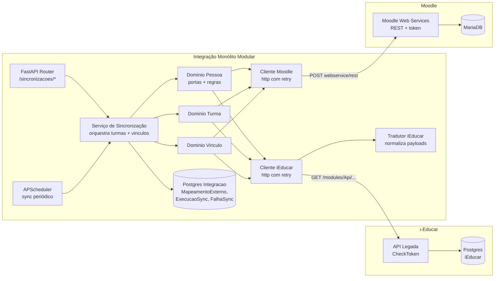
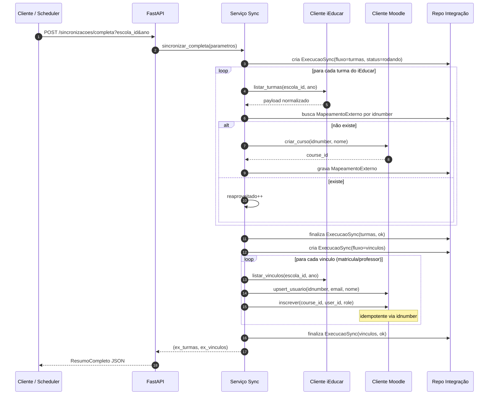
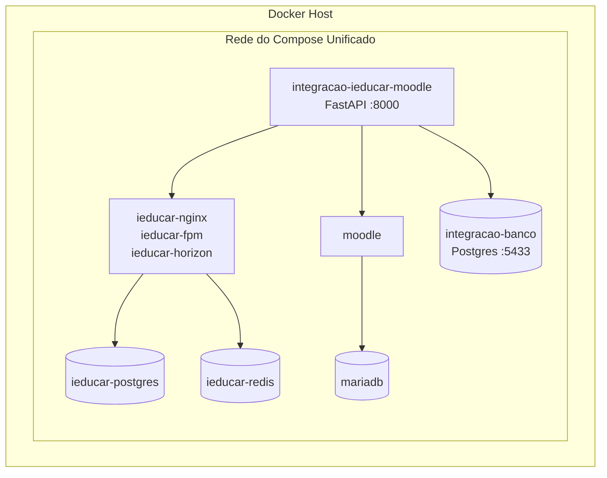

# Arquitetura

## Visão de componentes

## Fluxo de sincronização completa

## Deployment

## Decisões técnicas

| Decisão | Alternativa | Motivo |
|---|---|---|
| Monólito modular com portas por domínio | Microserviços | Escopo pequeno, deploy único, troca de clientes externos continua barata. |
| Sincronização síncrona com Postgres de controle | Fila (Celery/RabbitMQ) | Enunciado exige síncrono; auditoria completa cabe em 3 tabelas. |
| `idnumber` prefixado como chave de correlação | Guardar ID Moodle em iEducar | iEducar é read-only sob nossa ótica; `idnumber` já é um campo nativo do Moodle. |
| APScheduler in-process | Cron externo / Celery beat | Sem dependências extras; monólito já roda. Limitação assumida: single-instance. |
| SQLAlchemy 2.0 + psycopg3 | Django ORM | FastAPI-first, menos peso; migrações feitas por `create_all` (limitação assumida). |
| Clientes http + fake atrás da mesma porta | Mock em teste apenas | Fake acelera dev local e testes E2E sem precisar subir Moodle. |
| httpx com retry/backoff e classificação de erro | requests simples | Erros transitórios do iEducar/Moodle são comuns; isola falha fatal vs. retriável. |
